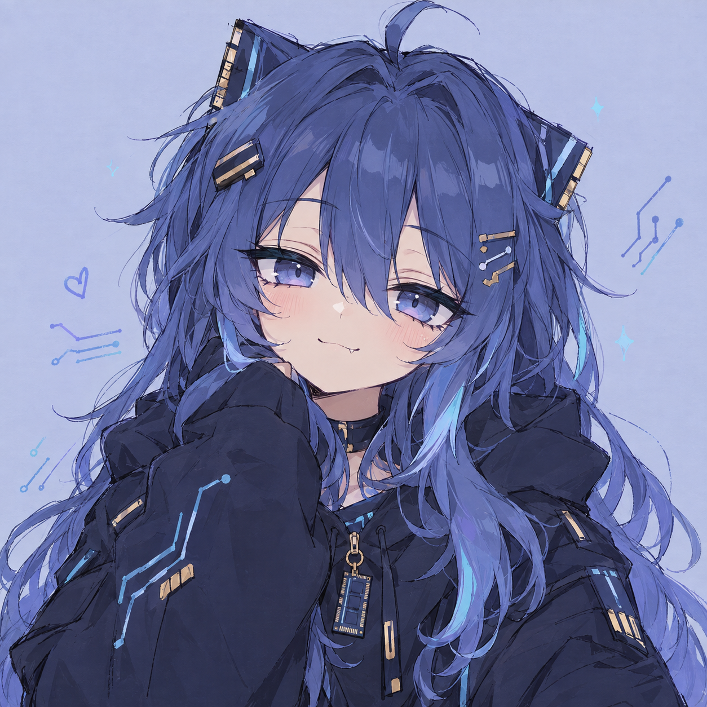

<div align="center">

<!-- Typing SVG Header -->
<a href="https://git.io/typing-svg">
  
</a>

<!-- Profile Views Counter Badge -->
<p align="center">
  <a href="https://github.com/DrxmReal">
    
  </a>
</p>

</div>

<br/>

<table>
  <tr>
    <td width="38%" align="center" valign="middle">
      
    </td>
    <td width="62%" valign="top">

```zsh
dr4m@cyberspace:~$ neofetch --profile
----------------------------------------------
👤 Identity    : Dr4m (DrxmReal)
🏫 Education   : CYP PTMC (Medical Student)
🌱 Medical Focus: Rehabilitation & Physical Therapy
💻 Passion     : Systems, Reverse Eng & Tool Development
💫 Core Skills : Rust, C++, Python, C#, React, PHP
🛠️ Philosophy  : Craft high-efficiency software with passion
🏃 Lifestyle   : Running • Cycling • Walking • Night Hacking
----------------------------------------------
```

  </td>
 </tr>
</table>

<br/>

### ⚡ Tech Stack & Technologies

<p align="left">
  
  
  
  
  
  
  
  
  
</p>

<br/>

### 📊 GitHub Activity & Statistics

<div align="center">
  
  
</div>

<br/>

---

<div align="center">
  <sub>✨ Designed with Cyberpunk Aesthetic • Maintained by Dr4m</sub>
</div>
